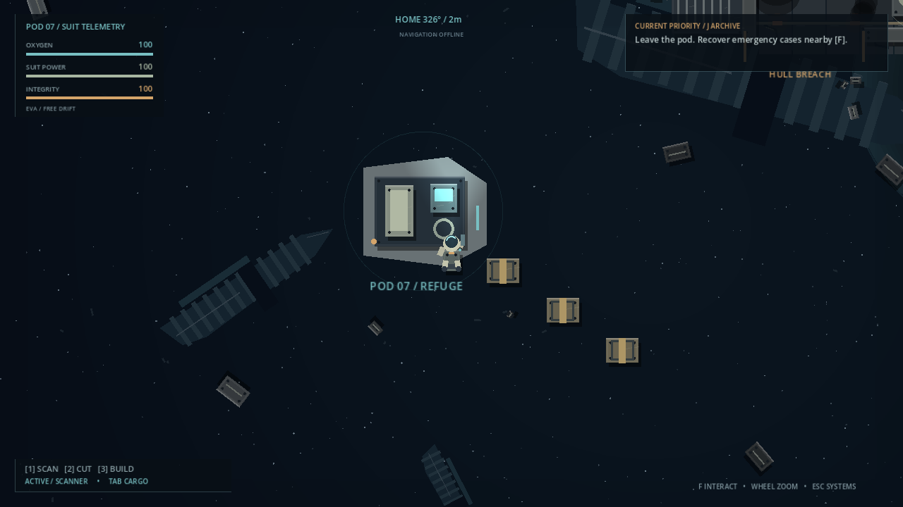

# GRAVEYARD — Quiet Drift

A playable single-player overhead space-survival slice in **Godot 4**, written entirely in GDScript. One survivor, a damaged escape pod, and a battlefield full of technology that can become a home. Restore a functioning station, then activate its long-range Navigation Array.

All visuals and suit audio are generated locally. No dependencies, downloaded assets, or network services are required.



## Run

Tested with **Godot 4.7.1 stable**, using the Compatibility/OpenGL renderer. Import `project.godot` in Godot and press **F5**. The configured main scene is `scenes/main.tscn`. Alternatively:

```powershell
& 'C:\Program Files\Godot\Godot.exe' --path .
```

Read the short diagnostic and select **Begin EVA**. The game starts beside Pod 07. The logical viewport is 1920×1080; the default window is 1280×720. Menus scroll where needed and pause suit simulation. **Resume Saved Expedition** appears when a save exists; the game otherwise starts a fresh expedition.

## Controls

| Input | Action |
|---|---|
| WASD / mouse | EVA thrust / aim |
| Shift / Space | Boost / active braking |
| Wheel / C | Smooth zoom / recenter |
| F | Recover cargo, read logs, open pod fabricator |
| 1 / 2 / 3 | Scanner / cutter / habitat builder |
| Hold left mouse | Scan or cut the aimed equipment within range |
| B / left mouse | Construction menu / confirm placement |
| R / right mouse | Rotate preview / cancel placement |
| E / T | Magnetic boots on a suitable floor / flashlight |
| Tab / J | Inventory and consumables / objectives and logs |
| M | Explored-space chart, after fabricating navigation equipment |
| Esc | Pause, save/load, settings, blueprint library, new game |
| F5 / F9 | Quick save / quick load |

Opposite thrust slows your drift; Space brakes more strongly. Use magnetic boots inside ships for precise movement. Tool beams require aim, range and unobstructed line of sight. Unfinished scans retain progress per fragment. Completed fragments cannot be researched twice.

## Walkthrough

1. Collect two or three amber emergency supply cases southeast of the pod with **F**. At the pod, **F** opens the fabricator. Fabricate the **Salvage Cutter**, **Habitat Builder** and, when affordable, **Navigation Instrument**. Initially only the scanner is owned.
2. Fly northeast to **Kestrel**, centered at **X +22m, Y −12m**. Approach the amber southern hull breach. Scan the damaged collector and habitat assembly with **1 + hold LMB**. Cut its two engine housings with **2 + hold LMB**.
3. Visit **Mnemosyne**, centered at **X +92m, Y +32m**. Its southern breach is near **X +83m, Y +40m**. Three compartments connect through the middle passage. Finish researching **Solar Collector (2 distinct fragments)**, **Habitat Room (3)** and **Oxygen Recycler (2)**. Recover cargo and cut equipment as needed. Orange electrical circles discharge periodically; wait for the arc to stop or go around it. Collect the flight recorder in the eastern compartment.
4. Return to the pod and build a connected station. A convenient layout uses **Habitat** one cell east of the pod, **Solar** south of that room, **Recycler** east of the solar collector, and reserves the cell east of the habitat for the array. **B** selects modules; move the preview, stand outside its footprint, and left-click on a green placement. Each grid cell is about **9.07m** wide. Any orthogonal docking connection is compatible. Rooms need connected power **and** a recycler to replenish your suit. A solar collector generates **12 kW**; room, recycler and array consume **1 + 3 + 6 kW**.
5. Use the recorder's coordinates/waypoint to find **Eurydice**, centered at **X +210m, Y −105m**. The southern breach is near **X +193m, Y −93m**. Navigate through the open central passages, avoiding the electrical hazard. Scan **three Navigation Array assemblies** and cut at least two shielded reactor housings for rare components. Read the command archive for additional lore.
6. Return home and construct a **Navigation Array** on the connected, habitable station. Its activation completes the slice, detects distant contacts and hints at the eventual warp-gate objective. Exploration can continue.

The automated progression test completes this route using two emergency cases, two fighter housings, two cargo lockers and two frigate housings. Extra salvage provides ample alternatives. Inventory holds **280 resource units**; build or fabricate to free space, or discard five units at a time from Tab. Oxygen lasts approximately **9 minutes** from full reserves; the pod and habitable rooms refill oxygen and power. Craft portable oxygen and repair kits as desired.

## Implemented systems

- Continuous **600×400m** battlefield with fighter, 36m cargo wreck, 72m frigate, off-route cache and unidentified signal.
- Collision-capable EVA movement, momentum, boost, counter-thrust, magnetic walking and flashlight.
- Smoothed Camera2D following, directional look-ahead and continuous **0.375–2.25** zoom.
- Five depth layers: deep stars/haze, celestial limb, distant decorative hulks, gameplay objects and sparse foreground fragments.
- Industrial procedural cutaway artwork, floor panels, hull ribs, conduits, weathering, consoles, emergency lights, beams, sparks and drifting debris.
- Health, oxygen, suit power, finite stack inventory, consumables and refuge recovery. Death restores the suit at the most recent refuge and loses **10% of each material stack**, rounded up. Research, tools and station survive.
- Seven salvage resources, authored loot tables, range/visibility checks, cutter progress and persistent depletion.
- Resource-backed recipes, unique fragment research, blueprint library, fabrication costs and equipment delivery.
- Grid placement, rotation, collision/overlap checks, assembly animation and connected power/life-support graph. Passive pod docking ports bridge the network; the pod does not generate station power.
- Navigation equipment, meter coordinates, compass, home/waypoint bearing, explored chart, recorded telemetry and confirmed/unconfirmed contacts.
- Objective checklist, recoverable logs, activation milestone, inventory/fabricator/build menus and audio/camera settings.
- Atomic local JSON save, load, new game, 90-second autosaves and saves after research, construction, fabrication and key discoveries.

## Saves

Godot stores `graveyard_save.json` in its `user://` directory, typically `%APPDATA%\Godot\app_userdata\GRAVEYARD — Quiet Drift\` on Windows. Save/load restores suit reserves and position, inventory, equipment, completed and partial scans, depleted salvage, modules, research, explored cells, discoveries, archive, waypoints, objectives and settings. Station networks are recalculated on load. Missing, malformed or incompatible saves leave the current session unchanged. **New Game restarts the session; its subsequent saves overwrite the single save slot.**

## Project layout

```text
scenes/main.tscn             configured game entry point
scenes/station/module.tscn   reusable constructible module scene
scripts/core/               data, authoritative state, orchestration, suit audio
scripts/player/             EVA movement, camera and suit rendering
scripts/world/              collision world, procedural art, layered background
scripts/crafting/           inspector-editable RecipeDefinition Resource
scripts/construction/       module presentation and collision
scripts/navigation/         explored-space chart and waypoint input
scripts/ui/                 screen-space HUD and all menus
resources/recipes/          ten editable .tres recipes / research definitions
tests/                      model, physics, integration and visual capture scripts
tools/test.ps1              Windows test runner with exit-status validation
docs/ARCHITECTURE.md         responsibilities and extension points
docs/VALIDATION.md           recorded checks and review scope
docs/screenshots/           inspected gameplay captures
```

## Validation

```powershell
# Imports all assets and registers global classes.
& 'C:\Program Files\Godot\Godot.exe' --headless --path . --editor --quit --log-file import.log

# Automated model and actual scene/physics/UI tests.
.\tools\test.ps1

# Also exercise and clean up a separate file in Godot's actual user directory.
.\tools\test.ps1 -UserData

# Regenerate visual review images in tests/ with a graphics-capable environment.
& 'C:\Program Files\Godot\Godot.exe' --path . --script tests/capture.gd --log-file visual.log
```

Tests use separate temporary save files and never overwrite the expedition save. Headless runs omit audio synthesis/playback; the graphical game has quiet breathing/mechanical ambience and tool/interaction/research tones. See [validation notes](docs/VALIDATION.md) for the recorded results and what was actually exercised.

## Simplifications and next steps

This is a handcrafted prototype, not a campaign. Modular rooms use four permanently open docking airlocks and a simplified life-support field; there is no pressure, leak or gas simulation. Solar/recycler/array hardware occupies whole grid modules. Rotation changes presentation; every side remains connectable. Fabricated equipment is recorded as suit equipment rather than an inventory cargo stack. All compartments remain cut away; the flashlight adds a local cone without occlusion shadows. Loot is deterministic. Map reveal uses 12m cells, and distant contacts after completion are narrative signals rather than new playable sectors. There is one save slot and no key rebinding or gamepad support.

Next development: dedicated module art/footprints and closed airlocks, reusable wreck scenes with authored light occlusion, configurable controls and accessibility, storage and deconstruction, new loot/research content, sensor triangulation, expanded signals and a warp-gate progression chain. Preserve stable content IDs or add save migrations when changing existing content.
